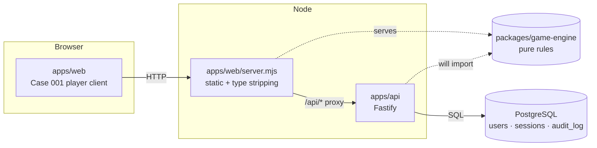
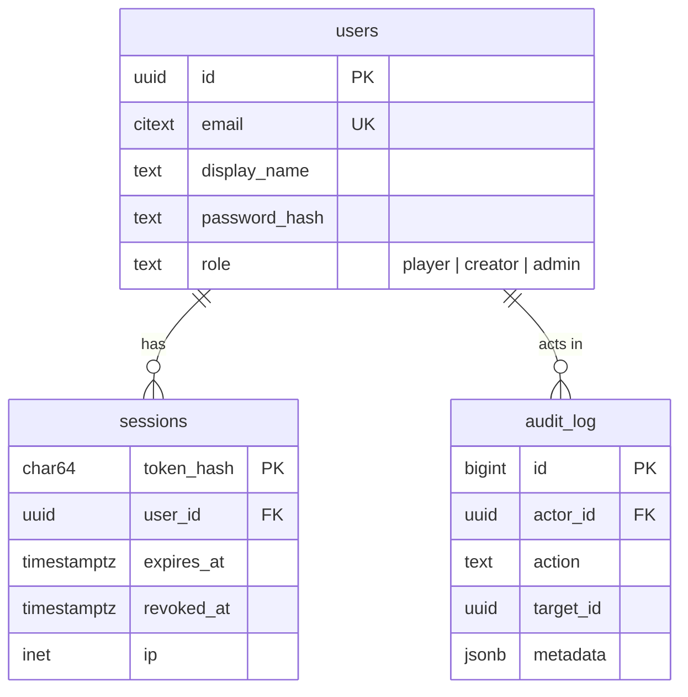
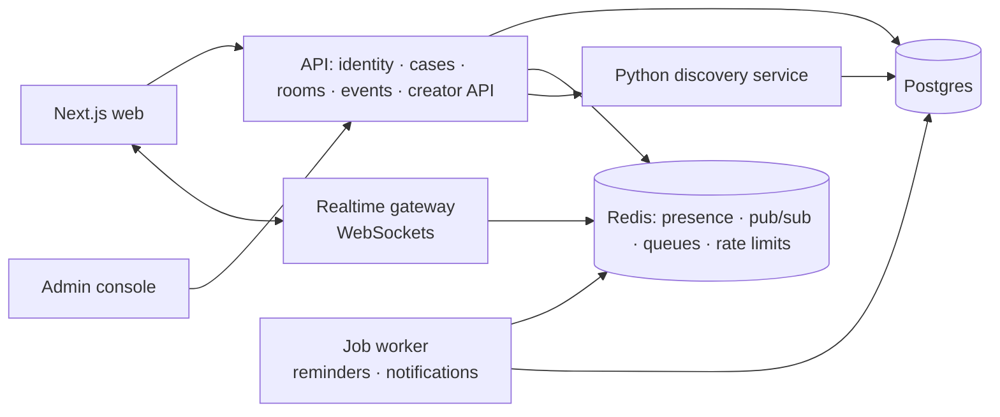

# Architecture overview

AFTERHOURS is a mystery-game platform. Players investigate cases alone or together,
communities gather for scheduled live "case nights", and creators publish their own cases.

## Current system (v0.3)

The browser only talks to the web server. It serves the game and forwards `/api/*` to
the API, so the session cookie is same-origin (ADR-0007). Case progress is still saved
in the browser until #5.

## Layers inside the API

| Layer | Example | Depends on |
|-------|---------|-----------|
| Routes | `auth/routes.ts` | Fastify, services |
| Services (business rules) | `auth/service.ts` | the `AuthStore` interface, limiters, a clock |
| Stores (persistence) | `auth/postgres-store.ts`, `auth/memory-store.ts` | `pg` / nothing |
| Infrastructure | `db/pool.ts`, `db/migrate.ts`, `config.ts` | `pg`, `zod` |

Rules never import Fastify or `pg`. That is what lets `auth-service.test.ts` run in
milliseconds with an in-memory store and a fake clock, while
`integration/postgres.test.ts` proves the SQL against a real database.

## Request lifecycle

1. `onRequest` hook reads the session token (cookie or Bearer), hashes it, and loads the
   active session joined to its user into `req.user`.
2. Route-level guards (`requireUser`, `requireRole('admin')`) reject with `401` / `403`.
3. The handler passes the raw body to a service, which validates it with zod.
4. Errors are `AppError`s with stable codes, serialised as
   `{ "error": { "code", "message", "details?" } }`. Anything else is logged and becomes a
   generic `500`.

## Data model

Constraints live in the database as well as the code: case-insensitive unique email
(`citext`), allowed roles (`CHECK`), sessions deleted with their user, audit rows kept
when a user is deleted.

## Where it is going

See [ROADMAP.md](../../ROADMAP.md). The planned shape:

Each new box arrives only with the feature that needs it; see the ADRs for the reasoning.
